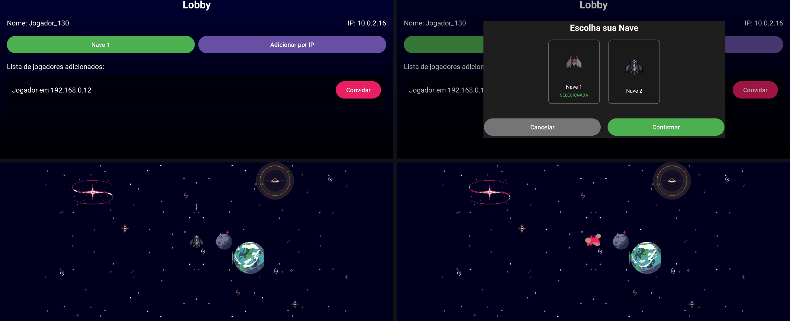
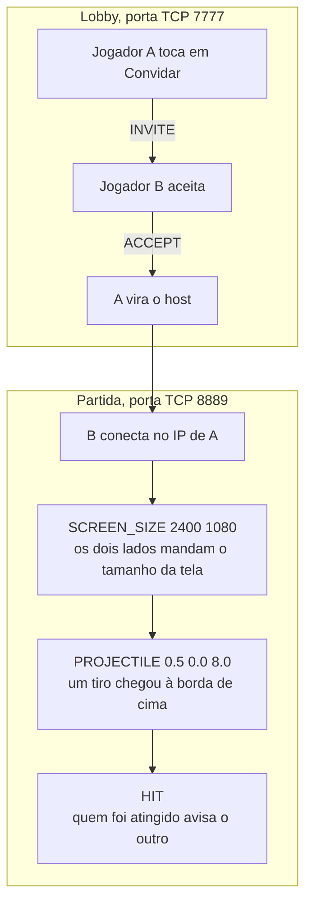

# SplitWars



*Prints de um emulador com Android 15: o lobby, a escolha da nave, um tiro do oponente chegando e a explosão da nave atingida.*

O SplitWars é um duelo de naves entre dois celulares Android, feito em Java. Os aparelhos se conectam por sockets TCP na rede local, e o tiro que sai pela borda de cima de uma tela aparece descendo na tela do outro celular. Quem é atingido perde.

## Por que existe

O SplitWars foi um trabalho da faculdade, feito em 2025 por uma pessoa só: um jogo para dois celulares na mesma rede, em que cada aparelho desenha o seu lado do jogo e conversa com o outro por sockets.

Depois da entrega, o código ganhou testes unitários, a licença MIT e três mudanças descritas em [Decisões de projeto](#decisões-de-projeto-e-por-quê): um protocolo de texto no lugar da serialização de objetos Java, a junção das duas classes de nave numa só e a correção da posição inicial da nave.

## O que dá para fazer

- Entrar no lobby, que mostra o nome sorteado (`Jogador_` mais um número) e o IP do celular na rede
- Escolher entre a Nave 1 e a Nave 2, que diferem no desenho, na velocidade das animações e no tamanho da área em que um tiro acerta. A escolha fica salva no aparelho
- Adicionar o outro jogador pelo IP e convidá-lo. No outro celular aparece o convite, que ele aceita ou recusa
- Mover a nave inclinando o celular (giroscópio, ou acelerômetro quando o aparelho não tem giroscópio) e atirar tocando na tela
- Ver o tiro que chegou à borda de cima descer na tela do oponente. Quem é atingido vê a explosão e **VOCÊ PERDEU!**, e o outro vê **VOCÊ GANHOU!**. Os dois podem jogar de novo ou voltar ao menu

## Stack

- Java 11 e Android SDK 35, com mínimo no Android 7.0 (API 24)
- AndroidX (AppCompat, ConstraintLayout e RecyclerView) e Material Components
- `ServerSocket` e `Socket` do Java para o lobby (porta 7777) e para a partida (porta 8889), sem biblioteca de rede
- `View` e `Canvas` do Android para desenhar o jogo
- `SensorManager` para o giroscópio, `MediaPlayer` para a música de fundo e `SoundPool` para o som do tiro
- `SharedPreferences` para guardar a nave escolhida
- JUnit 4 para os testes unitários
- Gradle com Kotlin DSL e catálogo de versões (`gradle/libs.versions.toml`), com o plugin do Android 8.10.0 e o Gradle 8.11.1

## Como funciona



O lobby usa mensagens de uma linha, no formato `SPLITWARS|INVITE|nome`, enviadas por uma conexão TCP curta para a porta 7777 do outro celular. Quando o convite é aceito, quem convidou abre um `ServerSocket` na porta 8889 e espera até 30 segundos, e quem aceitou conecta nesse IP, com até 3 tentativas.

Na partida, cada celular desenha e calcula o seu próprio jogo. A `ShipView` move a nave com a velocidade que o sensor informa, anima os tiros e testa as colisões. Só o tiro cruza de uma tela para a outra: quando o tiro de um jogador chega à borda de cima, o `GameView` manda um `PROJECTILE` com a posição na largura da tela, e o outro celular cria um tiro nessa posição, na borda de cima, descendo. Se esse tiro acerta a nave, o celular que foi atingido mostra a explosão e manda um `HIT`.

O `NetworkManager` tem uma thread que lê as linhas do socket e guarda só a última mensagem recebida. O `GameView` consulta essa mensagem a cada 17 ms e age conforme o tipo. O envio sai de um pool de threads, por um `MessageWriter` sincronizado.

### O protocolo da partida

Uma linha de texto por mensagem, com os campos separados por um espaço. Os números decimais levam sempre ponto, qualquer que seja o idioma do celular.

| Linha | Quando é enviada |
|---|---|
| `SCREEN_SIZE <largura> <altura>` | Uma vez, 2 s depois de a partida abrir, se já houver conexão. O tamanho é o da tela, em pixels |
| `PROJECTILE <relativeX> <speedX> <speedY>` | Quando um tiro chega à borda de cima. `relativeX` é a posição na largura da tela, de 0 a 1 |
| `HIT` | A nave foi atingida |
| `DISCONNECT` | O jogador saiu da partida |

O `MessageReader` ignora a linha que não segue esse formato, o que inclui números que não são finitos (`NaN` e infinito) e tamanhos de tela fora de 1 a 16384. Uma linha com mais de 128 bytes derruba a conexão em vez de ser guardada na memória.

| Classe | O que faz |
|---|---|
| `MainActivity` | Tela inicial, com o botão **Entrar no Lobby** |
| `LobbyActivity` | Mostra nome e IP, guarda a nave escolhida, mantém a lista de jogadores adicionados e troca os convites pela porta 7777 |
| `GameActivity` | Monta a partida: nave, sensor, música, rede e o diálogo de fim de jogo. Confere a conexão a cada 3 s e fecha a partida se ela cair |
| `GameView` | Não desenha nada. Consulta as mensagens da rede a cada 17 ms, aplica à nave a área calculada pela `PlayableArea` e decide o que fazer com `PROJECTILE`, `HIT` e `SCREEN_SIZE` |
| `ShipView` | A nave, os tiros, as explosões e a propulsão: movimento, animação, desenho e colisão |
| `ShipConfig` | Os valores que mudam de uma nave para a outra: sprites, velocidade e escala das animações, posição da propulsão e áreas de colisão |
| `PlayableArea` | Calcula a parte da tela em que a nave anda, a partir do tamanho das duas telas. Enquanto o tamanho de alguma delas não é conhecido, não há área |
| `SpaceView`, `PlanetView` e `MoonView` | O fundo animado |
| `NetworkManager` | Cria o jogo ou conecta no host, lê as mensagens numa thread e envia por um pool de threads |
| `NetworkMessage` | A mensagem em memória, com o tipo e os campos |
| `MessageCodec` | Converte uma `NetworkMessage` numa linha de texto e uma linha numa `NetworkMessage`, ou em `null` se a linha for inválida |
| `MessageReader` e `MessageWriter` | Leem e escrevem as linhas no socket, o leitor com o limite de 128 bytes e o escritor sincronizado |

As classes ficam todas em `com.example.splitwars`, sem subpacotes.

## Permissões

| Permissão | Para que o SplitWars usa |
|---|---|
| `INTERNET` | Abrir os sockets TCP do lobby e da partida |
| `ACCESS_WIFI_STATE` | Descobrir o IP do celular na rede, que o lobby mostra na tela |
| `ACCESS_NETWORK_STATE` | Está no manifesto, mas o código não a usa |

O manifesto também declara o giroscópio como obrigatório (`uses-feature`), embora o código aceite o acelerômetro quando não há giroscópio.

## Decisões de projeto (e por quê)

### 1. O tiro cruza a tela como fração da largura

O `PROJECTILE` leva a posição do tiro dividida pela largura da tela, de 0 a 1, e não em pixels. Assim, o tiro entra no outro celular no mesmo ponto relativo mesmo que as duas telas tenham resoluções diferentes.

### 2. Cada celular decide as suas colisões

Só o tiro atravessa o fio. Cada aparelho testa se os tiros do oponente acertam a sua própria nave e, se acertar, avisa com um `HIT`. Por isso a conversa tem só quatro mensagens, e os dois celulares não precisam concordar sobre a posição das naves.

### 3. Um protocolo de texto no lugar de objetos Java serializados

A primeira versão trocava `NetworkMessage` por `ObjectOutputStream` e `ObjectInputStream`. O `readObject` reconstrói o objeto que vier do outro lado, e o outro lado é qualquer aparelho que conecte na porta, já que nada é autenticado. Além disso, o formato só podia ser lido por outro programa Java, e a classe levava campos que nada usava (`x`, `y` e `originalShipType`).

Com uma linha de texto, o código só lê campos que ele mesmo valida. A conversa também pode ser lida a olho e imitada por qualquer programa: foi assim que o jogo foi testado, com um script no PC no lugar do segundo celular. O custo é que dois celulares com versões diferentes do app não se entendem.

### 4. Uma linha nunca ocupa mais de 128 bytes na memória

O `MessageReader` lê byte a byte e desiste ao passar de 128 bytes, em vez de montar a linha inteira antes de olhar o tamanho. Um oponente que mande dados sem fim de linha não consegue encher a memória do celular. Em teste, uma linha de 100 mil bytes fez o app fechar a conexão.

### 5. O envio é feito por uma thread de cada vez

O `NetworkManager` envia de um pool de threads. Sem o `synchronized` no `MessageWriter`, duas linhas gravadas ao mesmo tempo se misturariam no fio. Um teste com 8 threads e 800 mensagens confere que isso não acontece.

### 6. Uma só `ShipView`, e os números de cada nave em `ShipConfig`

As duas naves eram duas classes de mais de 650 linhas cada, iguais em tudo, menos em cerca de 15 números e nos 4 sprites. Agora há uma `ShipView` e um `ShipConfig` com os valores de cada nave, e o `GameActivity` escolhe com `setShipType`. Um teste fixa cada valor das duas naves, e a conferência foi feita comparando o código novo, linha a linha, com as duas classes antigas.

### 7. A nave só recebe um limite quando a tela do oponente é conhecida

Antes do `SCREEN_SIZE`, o `GameView` entregava à nave uma área jogável vazia, porque `playableWidth` e `playableHeight` começavam em 0. A `ShipView` empurrava a nave para fora da tela a cada passo da animação, e o desenho a recentralizava. O que o código indica é que, se o `SCREEN_SIZE` chegasse entre um passo e o desenho, o limite verdadeiro prendia a nave no canto de cima à esquerda, e o teste que a recentraliza, que usa `<`, não disparava mais. Essa sequência exata não foi observada, mas a medição abaixo mostra que tirar a área vazia faz o problema sumir.

No emulador, a nave nasceu na borda em 2 de 12 rodadas com as duas classes de nave separadas. Numa comparação alternada de 24 rodadas, a `ShipView` única sem a correção deixou a nave na borda em 6 de 12, e a versão corrigida, em 0 de 12. A conta da área ficou na `PlayableArea`, que devolve `null` enquanto algum tamanho de tela é desconhecido, e o `GameView` só aplica um limite quando recebe uma área de verdade. Pela leitura do código, a nave também ficava parada até o `SCREEN_SIZE` chegar, e agora se mexe desde o começo.

## Como rodar

Precisa do Android Studio, ou do JDK 17 ou mais novo com o Android SDK 35, e de dois celulares com Android 7.0 ou mais novo, na mesma rede Wi-Fi. Os dois precisam da mesma versão do app, por causa do protocolo.

1. Com o celular conectado, compile e instale o app. Repita no segundo celular:

   ```bash
   ./gradlew installDebug
   ```

   No Windows, use `gradlew.bat installDebug`. No Android Studio, basta abrir a pasta e rodar (Shift+F10).

2. Nos dois celulares, abra o app e toque em **Entrar no Lobby**. O IP do celular aparece no canto direito.

3. Se quiser, toque no botão da nave (**Nave 1**), escolha a **Nave 2** e toque em **Confirmar**.

4. Num dos celulares, toque em **Adicionar por IP**, digite o IP do outro e toque em **Adicionar**. Depois toque em **Convidar**.

5. No outro celular aparece **Convite para jogar**. Toque em **Aceitar**. Quem convidou vira o host, e a partida abre nos dois.

6. Incline o celular para mover a nave e toque na tela para atirar.

Os testes unitários do protocolo, das naves e da área jogável não precisam de celular nem de emulador: `./gradlew testDebugUnitTest` (no Windows, `gradlew.bat testDebugUnitTest`).

### Testar sem um segundo celular

Como o protocolo é texto, um programa no PC pode fazer o papel do oponente. Com um emulador (imagem Google APIs, em que o `adb root` funciona) e o app instalado, o `GameActivity` abre direto como host:

```bash
adb root
adb forward tcp:18889 tcp:8889
adb shell am start -n com.example.splitwars/.GameActivity --ez IS_HOST true --ei SELECTED_SHIP_TYPE 1
```

O programa conecta em `127.0.0.1:18889` em até 30 segundos e passa a trocar as linhas da tabela acima. O `adb forward` aceita a conexão mesmo antes de o app estar escutando e a fecha em seguida, então o programa deve tentar de novo até a conexão ficar aberta. O app manda o `SCREEN_SIZE` 2 segundos depois de abrir, e um `PROJECTILE 0.5 0.0 8.0` mandado de volta desce pelo meio da tela. O jogo foi testado assim, num emulador com Android 15, com a nave 1 e com a nave 2.

Para testar o app no papel de convidado, o programa escuta em `127.0.0.1:8889` antes de o app abrir, e o app conecta nele. Dentro do emulador, o endereço do PC é `10.0.2.2`:

```bash
adb shell am start -n com.example.splitwars/.GameActivity --ez IS_HOST false --es OPPONENT_IP 10.0.2.2 --ei SELECTED_SHIP_TYPE 1
```

O app foi testado nos dois papéis, com o mesmo resultado.

## Limitações

- Não foi testado em dois celulares de verdade. Os testes com a rede foram feitos com um emulador e um script no PC, e com telas do mesmo tamanho. A conta da área em que a nave anda quando as proporções são diferentes (`PlayableArea`) tem testes unitários, mas não foi conferida com duas telas diferentes de verdade
- Nada na rede é autenticado. Qualquer aparelho que mande `SPLITWARS|INVITE|nome` para a porta 7777 faz aparecer um convite, e um `SPLITWARS|ACCEPT|nome` de qualquer IP abre a partida como host. Na partida, o host aceita a primeira conexão que chegar à porta 8889 em até 30 segundos
- A lista do lobby só se preenche pelo botão **Adicionar por IP**. O código trata uma mensagem `PRESENCE`, mas nada a envia
- O `NetworkManager` guarda só a última mensagem recebida, e o `GameView` a consulta a cada 17 ms. Duas mensagens que cheguem com menos de 17 ms de diferença perdem a primeira
- O `SCREEN_SIZE` sai uma única vez, 2 segundos depois de a partida abrir, e só se já houver conexão. Quem conectar depois disso não recebe o tamanho da outra tela
- A música de fundo é, segundo o autor, do jogo R-Type Leo, mas isso não foi confirmado e o arquivo não traz a origem. Ela pertence aos donos do jogo, e o repositório não tem uma licença deles para usá-la. O som do tiro e as imagens (`res/raw` e os `spr_*.png` de `res/drawable`) não têm a origem documentada. A licença MIT do repositório não cobre nenhum desses arquivos

## Próximos passos

- Guardar as mensagens recebidas numa fila, em vez de só a última
- Mandar o `SCREEN_SIZE` quando a conexão abre, em vez de 2 segundos depois da tela
- Aceitar um `ACCEPT` só de quem foi convidado, e pensar numa forma de confirmar quem está do outro lado
- Descobrir os jogadores da rede automaticamente, o que passa por mandar o `PRESENCE` que o código já sabe ler
- Testar com dois celulares de verdade, com telas de tamanhos diferentes
- Trocar a música por um arquivo com licença conhecida, e achar a origem do som do tiro e dos sprites ou trocá-los também
- Escrever testes do `NetworkManager` com sockets reais no PC. Hoje só o protocolo, o `ShipConfig` e a `PlayableArea` têm testes

## Licença

[MIT](LICENSE), para o código. A música de fundo, o som do tiro e as imagens não são cobertos por ela. A música é, segundo o autor, do jogo R-Type Leo e pertence aos donos dele; a origem do som do tiro e das imagens não está documentada.
